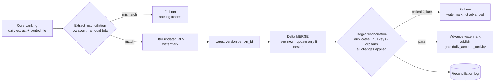

# Banking CDC Loads with Automated Reconciliation


  

Daily **incremental CDC loading** of core-banking transactions with **watermarks, Delta Lake MERGE, and automated reconciliation gates**. Data is only published, and the watermark only advances, when every critical check passes, which is how regulated financial data needs to be handled.

> All data is **synthetic**: accounts, transactions, and source control files are generated by this repo.

## Flow



## What makes it production-grade

- **Two reconciliation gates.** The extract is checked against the source system's control totals (record count and amount sum) before loading. The target is then checked for duplicate transaction IDs, null keys, orphan accounts, unknown transaction types or statuses, and whether every change in the increment actually landed.
- **Out-of-order safe.** The MERGE only updates a transaction when the incoming `updated_at` is newer, so replayed or late extracts can never overwrite a newer status (unit tested).
- **CDC semantics.** Pending transactions settle or reverse on later days; those updates are merged in place instead of appended, so the table always holds one current version per transaction.
- **Restartable.** The watermark lives in a control table and advances only after a successful, reconciled load. A failed day can be re-run safely.
- **Orchestrated.** `dags/banking_daily_cdc.py` is an Airflow DAG with a file sensor on the control file, a Databricks run, retries with exponential backoff, failure emails, and `max_active_runs=1` to keep loads in order.

## Sample run (3 business days, synthetic data)

| Business date | Extract rows (incl. updates and re-sent dupes) | Changes applied | Target rows | Checks passed |
|---|---|---|---|---|
| 2026-01-01 | 4,040 | 4,000 | 4,000 | 9 / 9 |
| 2026-01-02 | 4,355 | 4,315 | 8,000 | 9 / 9 |
| 2026-01-03 | 4,480 | 4,440 | 12,000 | 9 / 9 |

Updates to earlier transactions are merged in place, so the target grows by exactly 4,000 new transactions per day. Reconciliation log for 2026-01-03:

| Check | Severity | Status | Expected | Actual |
|---|---|---|---|---|
| extract_record_count | CRITICAL | PASS | 4480 | 4480 |
| extract_amount_total | CRITICAL | PASS | 11219632.23 | 11219632.23 |
| no_duplicate_txn_ids | CRITICAL | PASS | 0 | 0 |
| no_null_keys | CRITICAL | PASS | 0 | 0 |
| no_orphan_accounts | CRITICAL | PASS | 0 | 0 |
| known_txn_codes | CRITICAL | PASS | 0 | 0 |
| all_changes_applied | CRITICAL | PASS | 0 | 0 |
| positive_amounts | WARNING | PASS | 0 | 0 |
| no_stale_pending | WARNING | PASS | 0 | 0 |

The tests also prove the gates work: a truncated extract and a control file that doesn't match both stop the run before anything is written.

## Run it locally

Requires Python 3.10+ and Java 17.

```bash
pip install -r requirements.txt
PYTHONPATH=src python -m banking_cdc.generate_data --out data --days 3

for d in 2026-01-01 2026-01-02 2026-01-03; do
  PYTHONPATH=src USE_DELTA=1 python -m banking_cdc.pipeline --data-dir data --business-date $d
done

pytest -q
```

`USE_DELTA=1` uses Delta Lake MERGE; `USE_DELTA=0` uses an equivalent DataFrame upsert on Parquet (used in CI).

## Project structure

```
src/banking_cdc/
  generate_data.py    synthetic accounts, CDC-style extracts, control files
  incremental.py      watermark filter, latest-version dedup, Delta MERGE upsert
  reconciliation.py   extract + target checks, report, publish gate
  watermark.py        watermark control table
  pipeline.py         daily runner
dags/                 Airflow DAG (Databricks + sensors + retries)
tests/                unit tests + 3-day end-to-end + failure-path tests
```

## Tech stack

PySpark · Spark SQL · Delta Lake MERGE · Azure Databricks · Apache Airflow · pytest · GitHub Actions
